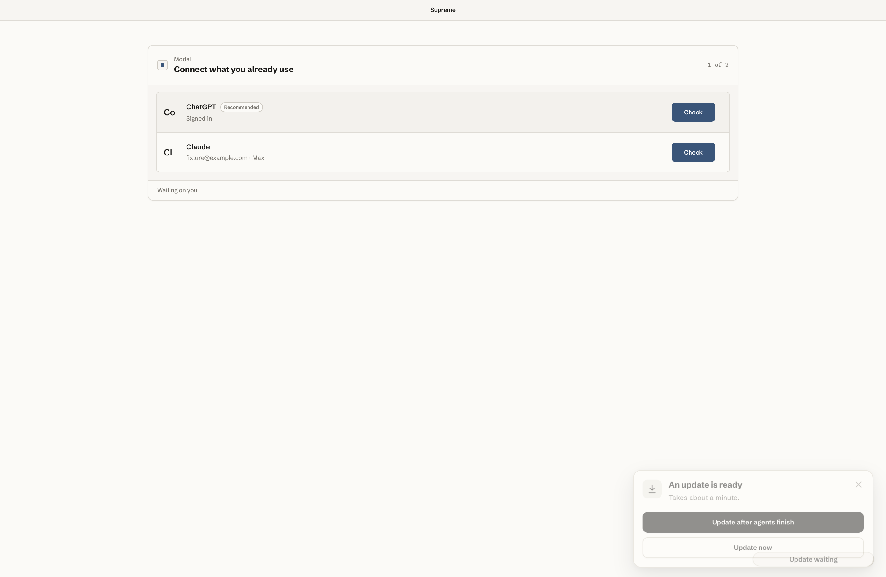

# Supreme Community

A local workspace for Claude and Codex on macOS. Work in parallel conversations, switch models with context, compare answers with Duels, and keep your work on your own machine.

This is the community source edition of **Supreme 0.1.119**, before the dedicated Agents interface and the later Apex product. It includes the original desktop shell, local server and React client, with the publication changes listed in [SOURCE_PROVENANCE.md](SOURCE_PROVENANCE.md).

[Download the signed Supreme 0.1.119 installer for Apple silicon](https://github.com/chips2011/supreme-releases/releases/download/v0.1.119/Supreme-0.1.119-arm64.dmg) · [Website](https://meetsupreme.com) · [Contributing](CONTRIBUTING.md)

## Run from source

Requirements: macOS, Git, Node.js 24 or 26, and npm. Install and sign in to a supported model CLI separately if you want to run model tasks. Provider accounts, subscriptions and usage are your responsibility.

```sh
git clone https://github.com/chips2011/supreme-community.git
cd supreme-community
npm ci
npm --prefix web ci
npm run build
npm start
```

Open **http://127.0.0.1:4757**. No Supreme account, Supabase project or API key is needed to open the local app. Connect your own model account in the app. Unconfigured model or integration features remain unavailable until you connect them.

Community source defaults to `~/.supreme-community` for its data and port `4757`, separate from the installed Supreme app. Set `WORKBENCH_HOME` to an absolute path and `PORT` to override them. Project folders and model credentials remain on your Mac.

## Desktop application

After building the web client:

```sh
npm --prefix desktop ci
npm --prefix desktop run dev
```

To create a local, unsigned Apple silicon application:

```sh
CSC_IDENTITY_AUTO_DISCOVERY=false npm --prefix desktop run pack
```

The app is created at `desktop/dist/mac-arm64/Supreme Community.app`. It uses a separate application ID and browser profile. Community builds do not register the official app's URL schemes or use its update feed by default. See [desktop/README.md](desktop/README.md).

The source edition includes publication changes and is not a byte-for-byte reproduction of the existing signed installer. Signing credentials and notarization are not needed for local development and are not included.

## Development and verification

```sh
npm run typecheck
npm test
npm run test:local
npm run check:publication
```

`npm test` runs the selected existing unit suites. `test:local` boots the original API acceptance tests with synthetic model CLIs, isolated temporary data and cloud configuration disabled. They do not send customer messages or require paid model calls. GitHub Actions also checks a fresh install and build. Optional services and live provider authentication are not covered by these offline checks.



Packaged readiness check with fixture accounts and simulated update controls.

## Optional integrations

Local use needs no environment file. If configuring accounts or services, copy `.env.example` to `.env.local` and use your own infrastructure. Empty values keep accounts and sync off.

- **Supabase:** optional sign-in, sync and relay. See [supabase/SETUP.md](supabase/SETUP.md).
- **Slack:** connect your own bot in the app. OAuth requires your own Slack app and redirect handler. Client secrets are never staged into desktop bundles.
- **Cloud workers, inbound email and push:** deployment source is included for reference. These require your own services and credentials, and are not a hosted-service entitlement. See [docs/integrations.md](docs/integrations.md).
- **Phone client and TestFlight:** the native iOS project and invitation broker are outside this desktop source release.

The community client contains no production analytics configuration. Its analytics hooks are disabled. Models and integrations contact their respective providers when you use them.

## Security and licensing

The local service binds to loopback. Model tools can access files and run commands with your user permissions, so choose projects and connections deliberately. See [SECURITY.md](SECURITY.md) for reporting issues privately.

Supreme's original source in this repository is licensed under [Apache 2.0](LICENSE). Third-party components retain their own licenses. See [NOTICE](NOTICE), [THIRD_PARTY_NOTICES.md](THIRD_PARTY_NOTICES.md) and [licenses](licenses). Provider subscriptions, trademarks and hosted services are not granted by the source license.
